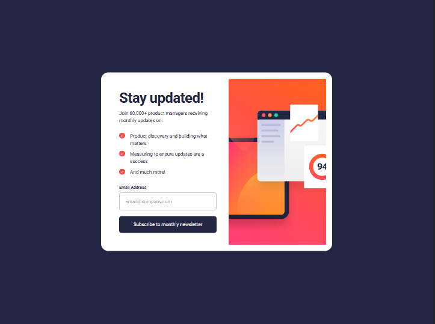
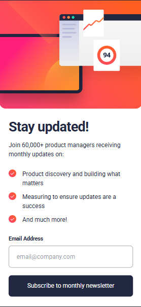

# 📩 Newsletter Sign-up Form with Success Message

A responsive and interactive newsletter sign-up form built with **React, TypeScript, Vite, and Tailwind CSS**.

This project recreates a newsletter subscription interface with email input, form validation, error feedback, and a success confirmation screen displayed after a successful submission.

The project focuses on **React state management, form handling, input validation, conditional rendering, responsive frontend development, and component-based architecture**.

---

## 🌐 Live Demo

🚀 **[View Live Website](https://newsletter-sign-up-interactive.vercel.app/)**

The project is deployed on **Vercel** and is available online for viewing and testing.

---

## 📸 Preview

### Desktop



### Mobile



---

## ✨ Features

- 📱 Responsive design for mobile and desktop screens
- 🧩 Component-based React architecture
- 📝 Interactive newsletter sign-up form
- ✉️ Email input with controlled form state
- ✅ Email format validation
- ⚠️ Custom validation and error messages
- 🔄 Form submission handling
- 🎉 Dynamic success confirmation screen
- 📧 Displays the submitted email address in the success message
- 🔙 Dismiss functionality to return to the sign-up form
- 🎨 Custom styling with Tailwind CSS
- ♿ Semantic HTML structure and accessible form labels
- 📐 Design-focused responsive layout
- 🔒 Type-safe development with TypeScript
- 🚀 Production deployment with Vercel

---

## 🛠️ Technologies

| Technology            | Purpose                                                      |
| --------------------- | ------------------------------------------------------------ |
| **React**             | Building interactive user interfaces and reusable components |
| **TypeScript**        | Static typing and safer development                          |
| **Vite**              | Development server and build tooling                         |
| **Tailwind CSS**      | Utility-first styling and responsive layouts                 |
| **JavaScript (ES6+)** | Form handling, validation, and application logic             |
| **ESLint**            | Code quality and linting                                     |
| **Vercel**            | Production deployment                                        |

---

## 🧱 Component Architecture

The application is divided into focused React components instead of placing the entire interface inside one component.

```text
App
│
├── NewsletterForm
│   │
│   ├── BenefitsList
│   │
│   └── EmailInput
│
└── SuccessMessage
```

The main application manages the submission state and determines which screen should be displayed.

- **NewsletterForm** — Handles the newsletter sign-up interface and form submission.
- **BenefitsList** — Displays the benefits of subscribing.
- **EmailInput** — Handles email input and validation feedback.
- **SuccessMessage** — Displays the subscription confirmation and submitted email address.

This approach keeps the code organized, reusable, and easier to maintain.

---

## 📁 Project Structure

```text
newsletter-sign-up/
│
├── public/
│   ├── images/
│   │   ├── illustration-sign-up-desktop.svg
│   │   ├── illustration-sign-up-mobile.svg
│   │   └── icon-success.svg
│   │   └── icon-list.svg
│   │
│   ├── active-status.png
│   ├── desktop-design.png
│   ├── desktop-success-active.png
│   ├── desktop-success.png
│   ├── error-state.png
│   └── mobile-design.png
│   └── mobile-success.png
│
├── src/
│   │
│   ├── components/
│   │   ├── BenefitsList.tsx
│   │   ├── EmailInput.tsx
│   │   ├── NewsletterForm.tsx
│   │   └── SuccessMessage.tsx
│   │
│   ├── data/
│   │   └── benefits.ts
│   │
│   ├── types/
│   │   └── index.ts
│   │
│   ├── utils/
│   │   └── validation.ts
│   │
│   ├── App.tsx
│   ├── index.css
│   └── main.tsx
│
├── index.html
├── eslint.config.js
├── style-guide.md
├── package.json
├── package-lock.json
├── tsconfig.json
├── tsconfig.app.json
├── tsconfig.node.json
├── vite.config.ts
└── README.md
```

The project separates UI components, static data, TypeScript definitions, and validation logic into dedicated directories.

---

## 🎨 Styling Approach

The project uses **Tailwind CSS** to handle styling, responsive layouts, and design consistency.

Custom design tokens are defined in the global CSS file using Tailwind CSS v4's `@theme` directive.

The styling approach includes:

- **Custom Colors** — Defined primary and neutral colors based on the design specifications.
- **Typography** — Roboto font family with 400 and 700 font weights.
- **Utility Classes** — Tailwind CSS classes for spacing, sizing, colors, and layout.
- **Responsive Styling** — Breakpoint-based layouts for mobile and desktop screens.
- **Interactive States** — Hover, focus, and validation error styles.

This approach makes it easier to maintain consistent styling while keeping component-specific styles close to the JSX.

---

## 📱 Responsive Design

The interface was designed to work across different viewport sizes, with particular attention to:

- Mobile layouts
- Desktop layouts
- Responsive image positioning
- Typography and readability
- Form input sizing
- Content spacing
- Button positioning
- Container sizing
- Responsive borders and border radius

The goal was to preserve the visual hierarchy and overall design while adapting the layout to smaller screens.

---

## ⚙️ Functionality

The project implements interactive form behaviour using React state and event handling.

### Email Input

The email input is controlled using React's `useState` hook, allowing the application to track changes as the user enters an email address.

### Email Validation

A custom validation utility checks the email format before allowing submission.

The form handles:

- Empty email submissions
- Invalid email formats
- Valid email addresses

### Form Submission

The form uses React's `onSubmit` event handler to process submissions without refreshing the page.

### Success Message

When a valid email address is submitted, the application switches from the newsletter form to a success confirmation screen.

The submitted email address is dynamically displayed in the confirmation message.

### Dismiss Functionality

The dismiss button resets the submission state and returns the user to the newsletter sign-up form.

---

## 🚀 Getting Started

### Prerequisites

Make sure you have the following installed:

- [Node.js](https://nodejs.org/)
- npm

### 1. Clone the repository

```bash
git clone https://github.com/CodeLord36/newsletter-sign-up-interactive
```

### 2. Navigate into the project

```bash
cd newsletter-sign-up
```

### 3. Install dependencies

```bash
npm install
```

### 4. Start the development server

```bash
npm run dev
```

Vite will start the development server and provide a local URL for the application.

---

## 📦 Available Scripts

### Development

```bash
npm run dev
```

Starts the Vite development server.

### Production Build

```bash
npm run build
```

Creates an optimized production build.

### Preview Production Build

```bash
npm run preview
```

Runs the production build locally for previewing.

### Lint

```bash
npm run lint
```

Runs ESLint against the project.

These scripts are defined in the project's `package.json`.

---

## 🧠 What I Learned

Building this project helped me strengthen several frontend development concepts.

### React State Management

I practiced using React's `useState` hook to manage form input values, validation errors, and submission states.

### Form Handling

I improved my understanding of handling form submissions using React event handlers, preventing default browser behaviour, and processing user input.

### Input Validation

I implemented custom email validation using regular expressions and conditional error messages to provide feedback when users submit invalid information.

### Conditional Rendering

I practiced using conditional rendering to switch between the newsletter sign-up form and the success confirmation screen based on the application's state.

### Component Architecture

I strengthened my understanding of breaking interfaces into smaller, reusable components and passing data and functions between components through props.

### TypeScript

I continued working with TypeScript in a React environment, defining component props, interfaces, and event types for safer development.

### Tailwind CSS

I practiced using Tailwind CSS v4 to create responsive layouts, manage custom design tokens, and implement interactive styling states.

### Responsive Design

I improved my understanding of adapting layouts across mobile and desktop screens while maintaining visual consistency and usability.

### Development Workflow

I also practiced the complete frontend development workflow:

```text
Design Reference
      ↓
Project Setup
      ↓
Component Planning
      ↓
React Development
      ↓
Tailwind CSS Styling
      ↓
Form Validation
      ↓
Interactive Functionality
      ↓
Responsive Testing
      ↓
Production Build
      ↓
Vercel Deployment
```

---

## 📚 Project Inspiration

This project was built as part of the **JavaScript Fundamentals Learning Path on Frontend Mentor**.

The challenge focuses on practicing basic form structure, validation, submission handling, and displaying a success state.

The implementation provided an opportunity to practise:

- React state management
- JavaScript event handling
- Form validation
- Conditional rendering
- DOM-related interaction concepts through React
- Responsive frontend development
- TypeScript
- Component-based architecture

---

## 📌 Project Status

**Completed ✅**

The current version successfully implements the newsletter sign-up interface, email validation, submission handling, and success confirmation screen.

The application handles the frontend subscription flow, but does not connect to an actual newsletter service or send confirmation emails.

Future development could include integrating a backend or newsletter service to manage real subscriptions.

---

## 👨‍💻 Author

### CodeLord36

Frontend developer building projects with modern web technologies and continuously improving software engineering skills.

**GitHub:**

[github.com/CodeLord36](https://github.com/CodeLord36)

**Project Repository:**

[github.com/CodeLord36/newsletter-sign-up-interactive](https://github.com/CodeLord36/newsletter-sign-up-interactive)

**Live Demo:**

[newsletter-sign-up-interactive.vercel.app](https://newsletter-sign-up-interactive.vercel.app/)

---

## ⭐ Acknowledgements

- [Frontend Mentor](https://www.frontendmentor.io/) for providing the challenge and design specifications.
- The frontend development community for the learning resources and inspiration.

---

### Built using React, TypeScript, Vite & Tailwind CSS
